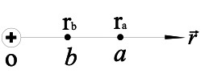
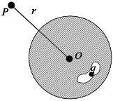
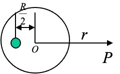
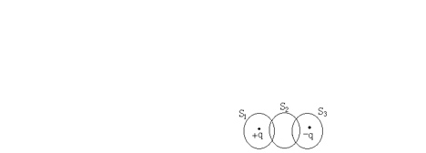
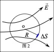
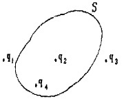

# 第一章：静电场

## 填空题答案

### 1

在正电荷 $q$ 的电场中，把一个试探电荷 $q_0$ 由点 $a$ 移到点 $b$，电场力所做的功为：

$$
\frac{q q_0}{4 \pi \varepsilon_0}\left(\frac{1}{r_a} - \frac{1}{r_b}\right)
$$

### 2

一条无限长均匀带电直线的线电荷密度为 $\lambda$，另一条长为 $L$、线电荷密度为 $\eta$ 的均匀带电直线 $AB$ 与其共面且垂直。若近端 $A$ 到无限长带电线的距离为 $a$，则带电线 $AB$ 所受静电力为：

$$
\frac{\eta \lambda}{2 \pi \varepsilon_0}\ln\frac{a+L}{a}
$$

### 3

一条无限长均匀带电直线的线电荷密度为 $\eta$，则离该带电直线距离分别为 $r_1$ 和 $r_2$ 的两点之间的电势差为：

$$
\frac{\eta}{2 \pi \varepsilon_0}\ln\frac{r_2}{r_1}
$$

### 4

一均匀带电球面，电量为 $Q$，半径为 $R$。在球内离球心 $R/2$ 处放一电量为 $q$ 的点电荷，假定点电荷的引入不破坏球面电荷的均匀分布，则整个系统在球外点 $P$ 产生的电场强度为：

$$
\frac{Q}{4 \pi \varepsilon_0 r^2} + \frac{q}{4 \pi \varepsilon_0 \left(r+\frac{R}{2}\right)^2}
$$

### 5

$\vec E$ 与 $U$ 的积分关系为：

$$
U=\int \vec E \cdot d\vec l
$$

微分关系为：

$$
\vec E=-\frac{\partial U}{\partial n}\vec n
$$

### 6

把一个均匀带电量为 $Q$ 的球形肥皂泡由半径 $r_1$ 吹到 $r_2$，则半径为 $r$ 且满足 $r_1<r<r_2$ 的高斯面上任一点的场强大小由

$$
\frac{kQ}{r^2}
$$

变为

$$
0
$$

### 7

真空中有一半径为 $R$、带电量为 $Q$ 的均匀带电球面。若在球面上挖去一小块带电面 $\Delta S$，则球心处场强为：

$$
\frac{k \sigma \Delta S}{R^2}
$$

### 8

正方体边长为 $a$，体心有一点电荷 $q$，则通过每个面的电通量为：

$$
\frac{q}{6\varepsilon_0}
$$

### 9

已知某电场中的电势为

$$
V=Ax^2-a^2
$$

则在 $x=b$ 处的电场强度为：

$$
2Ab
$$

### 10

两个点电荷 $2q$ 和 $q$ 相距 $l$，若第三个点电荷所受合力为零，则它应放在离 $2q$ 为

$$
\frac{3}{2}l
$$

的位置。

### 11

一均匀带电量为 $Q$ 的平面圆线圈，其半径为 $R$，则圆心处的电场强度为：

$$
0
$$

### 12

将一个点电荷 $q$ 放在边长为 $a$ 的立方体的一个角点上，则通过该立方体六个面的总电通量为：

$$
\frac{q}{\varepsilon_0}
$$

### 13

一电量为 $q$ 的试验电荷放在电场中某点时，受到向下的力，则该点的电场强度大小为

$$
\frac{kq}{r^2}
$$

方向向上。

### 14

设 $AC$ 为一根长为 $L$ 的带电细棒，左半部均匀带负电，右半部均匀带正电，电荷线密度分别为 $-\lambda$ 和 $\lambda$。若以棒中点 $B$ 为电势零点，则：

- $O$ 点电势为

$$
-\frac{k\lambda(2L-x)}{4\pi\varepsilon_0 x}
$$

- $P$ 点电势为

$$
0
$$

### 15

如图所示，四个等量点电荷距原点距离均为 $r$，则原点处：

- 电场强度为 $0$
- 以无穷远处为电势零点时，电势为 $\dfrac{kq}{r}$

### 16

已知两个同号点电荷之和为 $Q$，则当

$$
q_1=q_2,\qquad r_1=r_2
$$

时，相互作用力最大。

### 17

真空中，一均匀带电细圆环半径为 $R$，电荷线密度为 $\sigma$，则圆心处：

- 电场强度为 $0$
- 电势为

$$
\frac{kQ}{R}
$$

### 18

在空间有一非均匀电场，其电场线分布如图所示。作一半径为 $r$ 的闭合球面，已知通过球面上一面元的电通量为 $\Phi_1$，则通过球面其余部分的总电通量为：

$$
-\Phi_1
$$

### 19

在点电荷 $+q$ 和 $-q$ 的静电场中，图示三个闭合曲面 $S_1$、$S_2$、$S_3$ 的电通量分别为：

$$
\Phi_1=\frac{q}{\varepsilon_0},\qquad \Phi_2=0,\qquad \Phi_3=-\frac{q}{\varepsilon_0}
$$

### 20

真空中有一半径为 $R$、带电量为 $Q$ 的均匀带电球面。若在球面上挖去一小块带电面 $\Delta S$，则球心处场强可写为：

$$
\frac{Q\Delta S}{(4\pi R^2)^2\varepsilon_0}
$$

### 21

如图所示，在场强为 $E$ 的匀强电场中，取一半球面，半径为 $r$，电场方向与半球轴线成 $30^\circ$ 角，则通过该半球面的电通量为：

$$
\frac{1}{2}\pi r^2 E\cos 30^\circ
$$

### 22

一均匀静电场中，电场强度 $E=3\,\mathrm{V/m}$，则点 $a(3,2)$ 和点 $b(1,0)$ 之间的电势差 $U_{ab}$ 为：

$$
2000\,\mathrm{V}
$$

### 23

点电荷 $q_1$、$q_2$、$q_3$、$q_4$ 在真空中的分布如图所示，图中 $S$ 为闭合曲面，则通过该闭合曲面的总电通量为：

$$
q_1+q_2+q_3+q_4
$$

式中的 $\vec E$ 是这四个点电荷在闭合曲面上任一点产生的场强矢量和。

### 24

如图所示，在电荷为 $q_0$ 的点电荷静电场中，将一电荷为 $q_0$ 的试验电荷从 $a$ 点经任意路径移动到 $b$ 点，外力所作的功为：

$$
\frac{qq_0}{4 \pi \varepsilon_0}\left(\frac{1}{r_a}-\frac{1}{r_b}\right)
$$

### 25

沿等势面移动电荷时：

- 电场力做功为 $0$
- 等势面与电场线垂直
- 电场强度与电势之间的微分关系为

$$
E=-\nabla U
$$
