# 第四章：稳恒电流

## 填空题答案

### 1

电流稳恒条件的数学表达式为：

$$
\iint_S \vec J\cdot d\vec S=0
$$

### 2

对于图示三个一段含源电路，端电压 $U_{AB}$ 分别为：

- 图（a）

$$
U_{AB}=I(R+r)-\varepsilon
$$

**原图：**

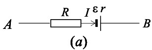

**矢量重绘（候选）：**

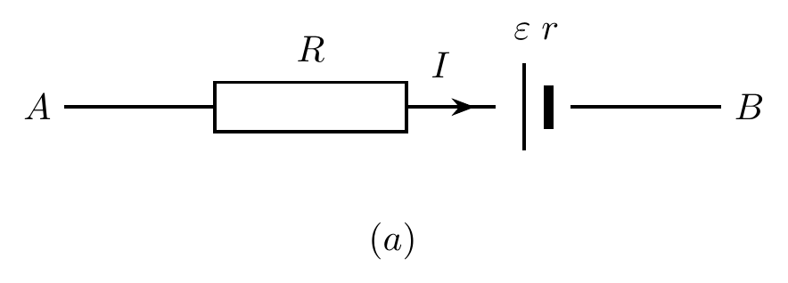

- 图（b）

$$
U_{AB}=\varepsilon-I(R+r)
$$

**原图：**

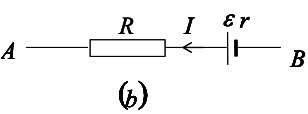

**矢量重绘（候选）：**

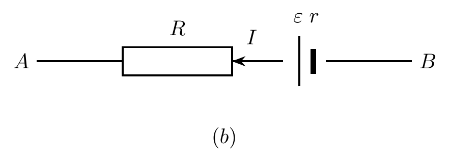

- 图（c）

$$
U_{AB}=\varepsilon+I(R_1+R_2+r)
$$

**原图：**

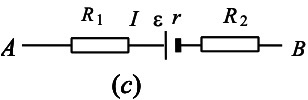

**矢量重绘（候选）：**

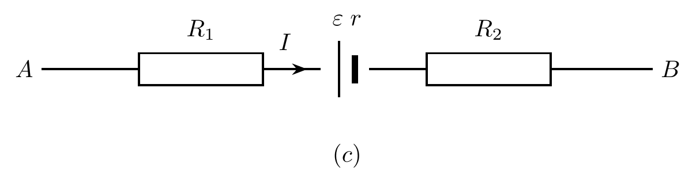

基尔霍夫第二定律的一般形式可写为：

$$
\sum(\pm \varepsilon_i)+\sum(\pm I_iR_i)=0
$$

> 注：确定正负号时，先规定回路绕行方向，再判断电动势和压降与绕行方向的相对关系。

### 3

两个同心导体薄球壳，半径分别为 $r_a$ 和 $r_b$，其间充满电阻率为 $\rho$ 的均匀介质。

- 两球壳之间的电阻为

$$
\frac{\rho}{4\pi}\left(\frac{r_b-r_a}{r_a r_b}\right)
$$

- 若两球壳间电压为 $U$，则电流密度为

$$
\frac{r_a r_b U}{\rho(r_b-r_a)r^2}
$$

推导如下：

$$
\begin{aligned}
U&=\int E\,dl=\int \frac{J}{\sigma}\,dl=\int \frac{I}{S\sigma}\,dl \\
&=\frac{I}{\sigma}\int \frac{1}{4\pi r^2}\,dr
=\frac{I}{4\pi\sigma}\left(\frac{1}{r_a}-\frac{1}{r_b}\right) \\
R&=\frac{U}{I}=\frac{\rho}{4\pi}\left(\frac{r_b-r_a}{r_a r_b}\right)
\end{aligned}
$$

以及

$$
\begin{aligned}
I&=\frac{U}{R}
=\frac{4\pi U r_a r_b}{\rho(r_b-r_a)} \\
J&=\frac{I}{4\pi r^2}
=\frac{r_a r_b U}{\rho(r_b-r_a)r^2}
\end{aligned}
$$

### 4

如图电路中，已知

$$
\varepsilon_1=12\text{V},\quad
\varepsilon_2=9\text{V},\quad
\varepsilon_3=8\text{V}
$$

且

$$
r_1=r_2=r_3=1\Omega,\quad
R_1=R_3=R_4=R_5=2\Omega,\quad
R_2=3\Omega
$$

则

$$
U_{ab}=1\text{V}
$$

**原图：**

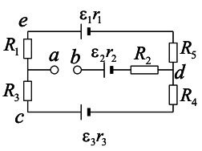

**矢量重绘（候选）：**

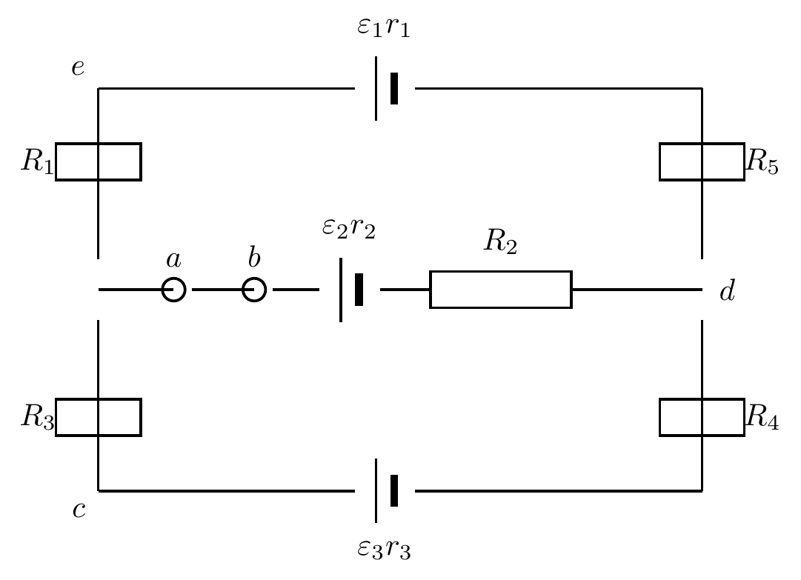

一种解法为：

$$
\begin{aligned}
IR_1&=IR_3 \\
\varepsilon_1-IR_1&=U_a=IR_3+\varepsilon_3 \\
U_a&=10\text{V},\qquad U_b=9\text{V} \\
U_a-U_b&=1\text{V}
\end{aligned}
$$

> 注：从物理上也可以理解为 $U_a=\dfrac{\varepsilon_1+\varepsilon_3}{2}$。

### 5

已知一段含源电路如图，则：

$$
U_A-U_B=\varepsilon_2-\varepsilon_1+I(R+r_1+r_2)
$$

**原图：**

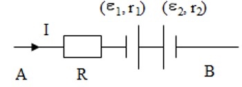

**矢量重绘（候选）：**

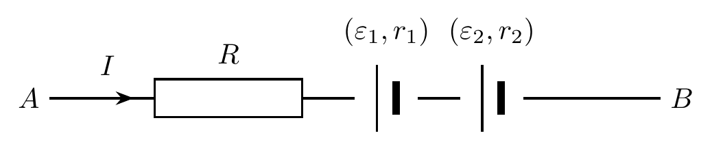

### 6

在图示电路中，等效电阻为：

$$
R_{AB}=10\Omega
$$

**原图：**

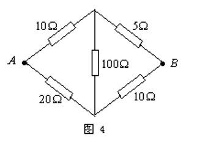

**矢量重绘（候选）：**

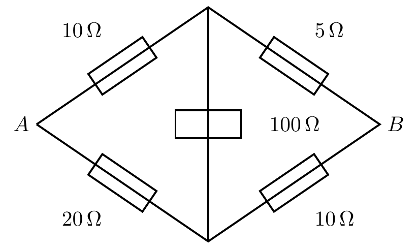

设通过 $10\Omega$、$20\Omega$、$100\Omega$ 支路的电流分别为 $I_1$、$I_2$、$I_3$，则可列：

$$
\begin{aligned}
-100I_3-5(I_1+I_3)+10(I_2-I_3)&=0 \\
-10I_1+100I_3+20I_2&=0 \\
I_0&=I_1+I_2
\end{aligned}
$$

进一步有：

$$
\begin{aligned}
-10I_1+25I_2-15I_3&=0 \\
5I_3&=-5I_1+10I_2 \\
U_B-U_A&=-10(I_1+I_2)=-10I_0
\end{aligned}
$$

因此

$$
R_{AB}=\frac{U_A-U_B}{I_0}=10\Omega
$$

### 7

一电池组内阻可忽略不计，接外电阻 $R$ 时电流为 $0.6\text{A}$；再串联一个 $4\Omega$ 电阻后，电流降为 $0.5\text{A}$。则：

- 电动势为

$$
12\text{V}
$$

- 外电阻为

$$
20\Omega
$$

由

$$
\frac{U}{R}=0.6,\qquad \frac{U}{R+4}=0.5
$$

可得上述结果。

### 8

如图所示电路的回路电压方程为：

$$
\varepsilon_1-I_1(r_1+R_1)+I_2(r_2+R_2)-\varepsilon_2=0
$$

> 校订：原稿中第二项内阻写作裸 $r$，对照图中标注（$I_2,\varepsilon_2,r_2,R_2$ 为同一支路），应为 $r_2$，现已更正。

**原图：**

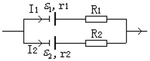

**矢量重绘（候选）：**

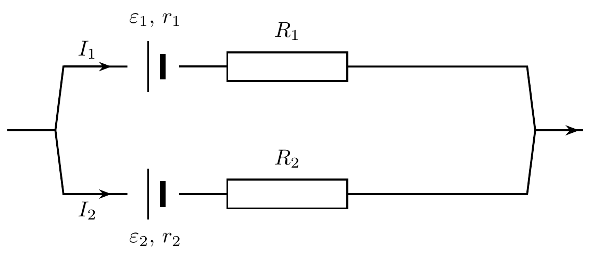

### 9

欧姆定律的微分形式为：

$$
\vec J=\sigma \vec E
$$

### 10

电源电动势可表示为：

$$
\xi=\int_-^+\vec E_{\text{非}} \cdot d\vec l
$$

### 11

基尔霍夫第一定律的内容是：

$$
\sum I_i=0
$$

其理论依据是：

$$
\iint_S \vec J\cdot d\vec S=0
$$

### 12

基尔霍夫第二定律的内容是：

$$
\sum \varepsilon_i+\sum I_iR_i=0
$$

其理论依据是：

$$
\oint_L \vec E\cdot d\vec l=0
$$
