# 第五章：磁场

## 填空题参考答案

### 1

一无限长均匀带电直线的线电荷密度为 $\lambda$，另一长为 $L$、线电荷密度为 $\eta$ 的带电直线 $AB$ 与其共面且垂直，若 $A$ 端到无限长带电直线的距离为 $a$，则带电线 $AB$ 所受静电力为：

$$
\frac{\eta\lambda}{2\pi\varepsilon_0}\ln\frac{a+L}{a}
$$

推导：

$$
\begin{aligned}
ES&=\frac{q}{\varepsilon_0}
\Rightarrow E=\frac{\lambda}{2\pi R\varepsilon_0} \\
F&=\int_a^{a+L}\frac{\lambda\eta}{2\pi R\varepsilon_0}\,dl
=\frac{\eta\lambda}{2\pi\varepsilon_0}\ln\frac{a+L}{a}
\end{aligned}
$$

### 2

一长螺线管通电流 $I$，若导线均匀密绕，则：

- 中部磁感应强度为

$$
\mu_0 n I
$$

- 端面处磁感应强度约为

$$
\frac{1}{2}\mu_0 n I
$$

圆环对轴线上一点的磁场可写为：

$$
B=\frac{\mu_0 I R^2}{2(x^2+r^2)^{3/2}}
$$

对螺线管积分后得到上述结果。

### 3

载流导线形状如图所示，$O$ 处磁感应强度大小为：

$$
\frac{\mu_0 I}{4R}
$$

**原图：**

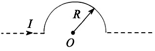

**矢量重绘（候选）：**

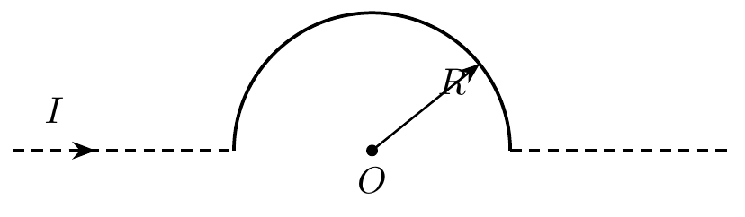

### 4

在磁感应强度为 $\vec B$ 的水平匀强磁场中，一段质量为 $m$、长度为 $L$ 的载流直导线竖直下落，其电流为 $I$，则下落速度为：

$$
\left(g-\frac{LIB}{m}\right)t
$$

### 5

与第 1 题同型，答案仍为：

$$
\frac{\eta\lambda}{2\pi\varepsilon_0}\ln\frac{a+L}{a}
$$

> 注：你原文中特别标记了这题重复出现。

### 6

两条无限长平行直导线相距 $a$，通以相等同向电流，则距两导线距离都为 $a$ 的点 $P$ 处磁感应强度大小为：

$$
\frac{\mu_0\sqrt{3}I}{2\pi a}
$$

### 7

一切磁现象的本质起源于：电流或电荷的运动。

### 8

两根导线沿半径方向接到铁环上 $B$、$C$ 两点，电流方向如图所示，则环中心 $O$ 处磁感应强度为：

$$
0
$$

**原图：**

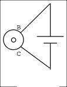

**矢量重绘（候选）：**

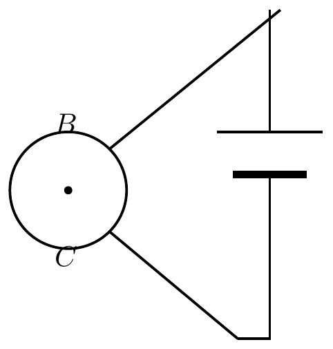

### 9

一载流为 $I$ 的平面圆线圈，半径为 $R$，其磁矩大小为：

$$
I\pi R^2
$$

### 10

载流导线形状如图所示，$O$ 处磁感应强度大小为：

$$
0
$$

**原图：**

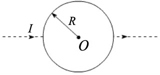

**矢量重绘（候选）：**

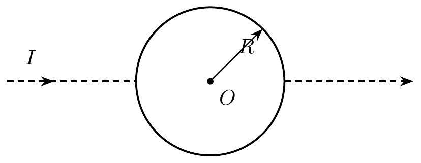

> 注：这里可直接利用第 8 题的结论。

### 11

半径为 $R$ 的圆柱体中通有均匀分布电流，一回路将其横截面分成面积 $S_1$ 和 $S_2$ 两部分，则：

$$
\int_L \vec B\cdot d\vec l=\mu_0 I\frac{S_1}{S_1+S_2}
$$

**原图：**

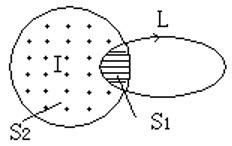

**矢量重绘（候选）：**

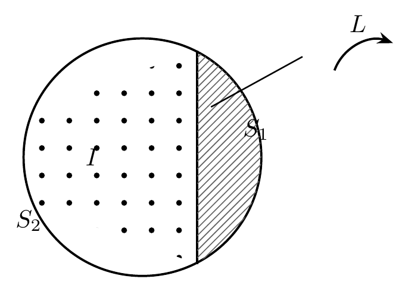

### 12

如图所示两个安培环路的环路积分分别为：

$$
0,\qquad 2\mu_0 I
$$

**原图：**

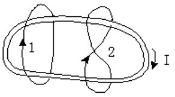

**矢量重绘（候选）：**

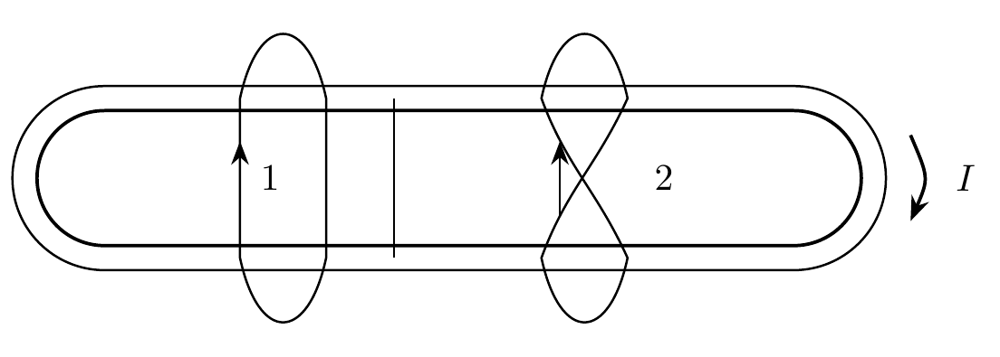

### 13

若磁感应强度为

$$
\vec B=a\vec i+b\vec j+c\vec k
$$

则通过半径为 $R$、开口朝 $z$ 方向的半球壳的磁通量大小为：

$$
\pi R^2 c
$$

> 校订：半球壳与其开口处的圆盘（半径 $R$，法向沿 $z$）共用同一条边界圆，且 $\vec B$ 均匀、$\nabla\cdot\vec B=0$，故两者磁通量相等，只需计算圆盘的通量 $\pi R^2 c$。原稿中记录的另一种写法 $\pi R^2 c/\sqrt{a^2+b^2}$ 在 $a=b=0$（场沿 $z$ 轴）时发散，而此时正确答案仍应是 $\pi R^2 c$，可见该写法不成立，予以删除。

### 14

无限长直导线在 $P$ 处弯成半径为 $R$ 的圆，当通以电流 $I$ 时，圆心 $O$ 处磁感应强度大小为：

$$
\frac{\mu_0 I}{2R}\left(1-\frac{1}{\pi}\right)
$$

**原图：**

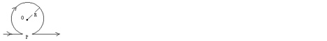

**矢量重绘（候选）：**

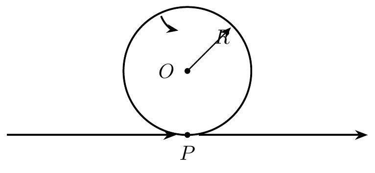

### 15

如图所示，两根载有相同电流的无限长直导线分别通过 $x=1$ 与 $x=3$ 的点，且平行于 $y$ 轴，则磁感应强度为零的位置在：

$$
x=2
$$

**原图：**

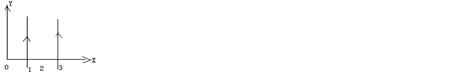

**矢量重绘（候选）：**

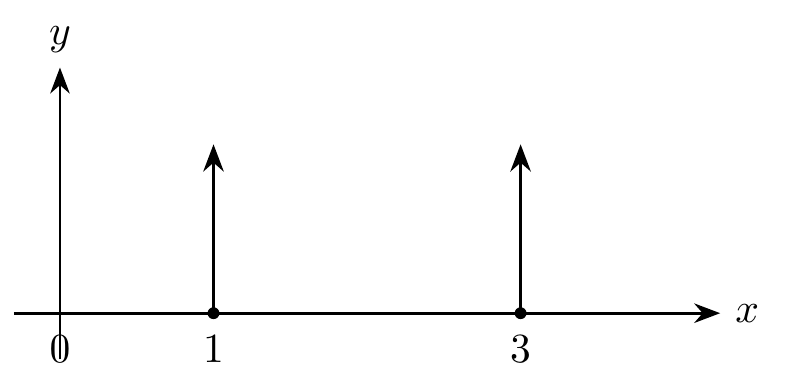

### 16

在安培环路定理

$$
\int_L \vec B\cdot d\vec l=\mu_0\sum I_i
$$

中：

- $\sum I_i$ 指环路所包围的所有稳恒电流的代数和
- $\vec B$ 指环路上的磁感应强度
- 它由环路内外全部电流共同决定

### 17

若通过 $S$ 面上某面元的元磁通变化对应题设比例，则结果为：

$$
1:2
$$

### 18

半径为 $R$ 的闭合球面包围条形磁铁的一端，则通过此球面的磁通量为：

$$
0
$$

### 19

一质量为 $m$、电量为 $q$ 的带电粒子在均匀磁场 $\vec B$ 中作半径为 $R$、螺距为 $h$ 的螺旋运动。若速度与磁场夹角为 $\theta$，则：

$$
\cos\theta=\frac{h}{\sqrt{(2\pi R)^2+h^2}}
$$

### 20

在磁场中分别取两个闭合回路，若它们包围的载流导线根数不同，但电流代数和相同，则：

- 磁感应强度沿各闭合回路的线积分相同
- 两回路上的磁场分布不相同

### 21

磁通量的单位为：韦伯。

### 22

如图，半径为 $R$ 的四分之一圆弧形载流导线 $ab$ 置于均匀外磁场 $B$ 中，电流为 $I$，则安培力大小为：

$$
BIR
$$

**原图：**

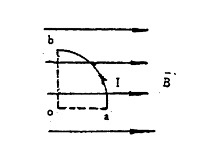

**矢量重绘（候选）：**

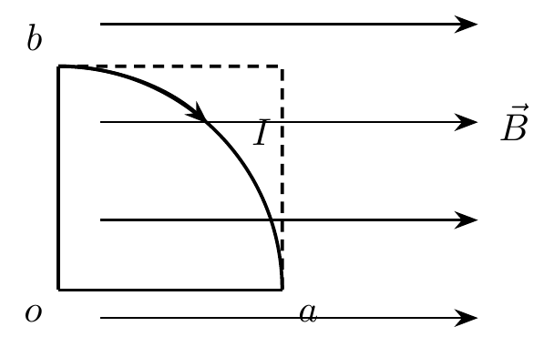

> 注：这里按你原文的思路，采用“安培力大小只与起点和终点位置有关”的结论。

### 23

在磁场中某点放一很小的试验线圈，若线圈面积增大一倍，电流也增大一倍，则最大磁力矩变为原来的：

$$
4\text{倍}
$$

> 注：因为磁矩 $p_m=IS$，面积和电流各增大一倍，磁矩增大为原来的 4 倍。
