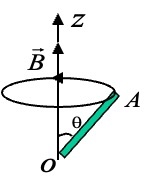
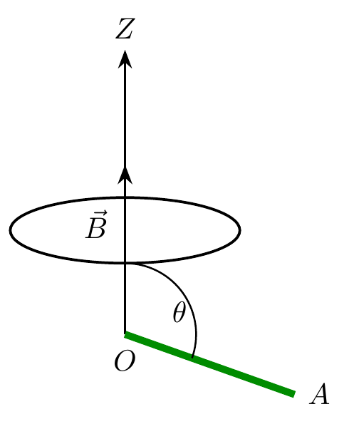
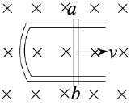
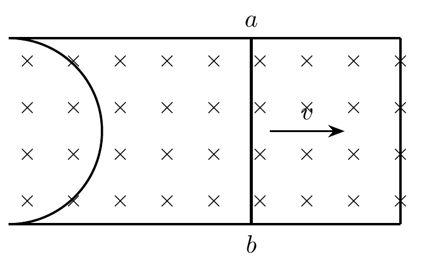
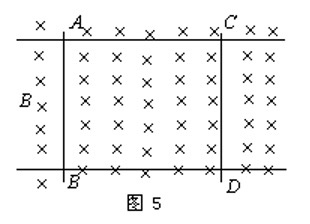
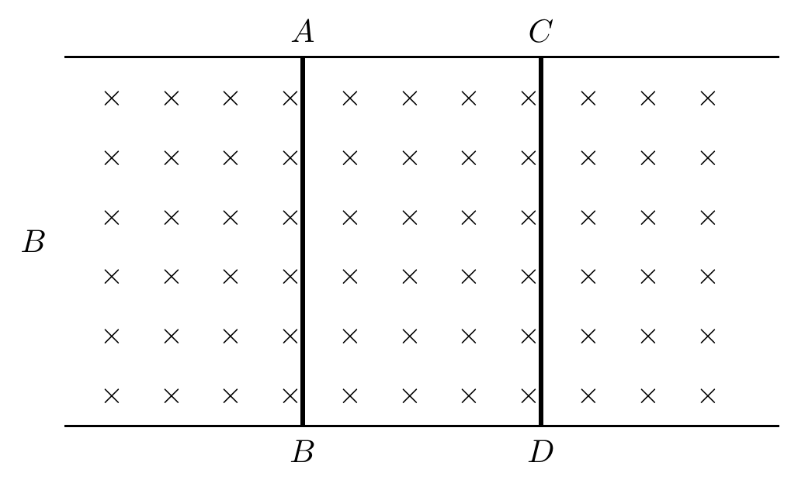

# 第六章：电磁感应

## 填空题参考答案

### 1

设存在一个区域很大的均匀磁场，一金属板以恒定速度 $V$ 在磁场中运动，板面与磁场垂直，则：

- 金属板中无感应电流
- 磁场对金属板运动有阻尼作用
- 金属板中有电动势
- 若用导线连接金属板两端，则导线中有电流

### 2

在磁感应强度为 $\vec B$ 的水平匀强磁场中，一段质量为 $m$、长度为 $L$ 的载流直导线竖直下落，导线中电流为 $I$，则下落速度为：

$$
\left(g-\frac{BIL}{m}\right)t
$$

推导：

$$
\begin{aligned}
ma&=mg-BIL \\
a&=g-\frac{BIL}{m} \\
v&=at=\left(g-\frac{BIL}{m}\right)t
\end{aligned}
$$

### 3

一金属细棒 $OA$ 长为 $L$，与竖直轴 $OZ$ 的夹角为 $\theta$，在均匀磁场中以角速度 $\omega$ 绕 $OZ$ 轴转动，则两端电势差为：

$$
U_O-U_A=-\frac{1}{2}\omega B L^2\sin^2\theta
$$

**原图：**

**矢量重绘（候选）：**

可写为：

$$
\varepsilon=\sin\theta\int_0^L r\sin\theta\,\omega B\,dr
=\frac{1}{2}\omega B L^2\sin^2\theta
$$

### 4

如图，矩形闭合导线回路中一边可滑动，长度为 $L$、速度为 $V$，则感应电动势大小为：

$$
BLV
$$

方向为：$b\to a$。

**原图：**

**矢量重绘（候选）：**

### 5

如图，两条金属导轨位于同一水平面上，导体 $AB$、$CD$ 可自由滑动。当 $AB$ 在外力作用下向左滑动时：

- $CD$ 向左滑动
- 磁场对 $AB$ 的作用力方向向右

**原图：**

**矢量重绘（候选）：**

### 6

产生动生电动势的非静电力是：洛伦兹力。  
相应的非静电场强为：

$$
\vec V\times\vec B
$$

### 7

电感的单位是：亨利。

### 8

感生电动势的起因是：涡旋电场。

### 9

一根长为 $L$ 的金属棒以角速度 $\omega$ 绕固定端匀速转动，均匀磁场 $\vec B$ 与棒垂直，则棒上的电动势为：

$$
\frac{1}{2}\omega B L^2
$$

### 10

有一无限长螺线管，每米 800 匝。在其中心放置一个匝数为 30、半径为 $0.01\text{m}$ 的圆形小线圈，并使其轴线与螺线管轴线平行。若在 $0.01\text{s}$ 内，将螺线管中的电流从 $0$ 均匀增大到 $5.0\text{A}$，则小线圈中的感应电动势为：

$$
4.74\times 10^{-3}\text{V}
$$

### 11

一段长度为 $L$ 的直导线 $MN$ 水平放置在载流竖直长导线旁，与该长导线共面，并从静止自由下落。若水平导线距载流导线最近端距离也为 $L$，则在 $t$ 秒末两端电势差为：

$$
U_M-U_N=\frac{\mu_0 Igt}{2\pi}\ln 2
$$

> 校订：原稿中记录的推导步骤有误——其中 $B=\dfrac{\mu_0 I}{4\pi}\displaystyle\int_{-\infty}^{\infty}\dfrac{dx}{x^2+L^2}$ 其实是圆形载流线圈轴线上磁场的积分形式，并不适用于长直导线；随后的 $\Phi=L\displaystyle\int_0^x\dfrac{\mu_0 I}{2\pi r}\,dr$ 在 $r=0$ 处发散，也不能给出有限结果。下面给出与最终答案一致的正确推导。

设导线竖直放置，杆 $MN$ 水平放置，与导线共面；杆上一点到导线的水平距离为 $x$，长直导线在该处产生的磁场大小为

$$
B(x)=\frac{\mu_0 I}{2\pi x}.
$$

杆自由下落，$t$ 秒末速度为 $v=gt$（竖直方向，与导线平行）。动生电动势为

$$
U_M-U_N=\int_L^{2L}\big(\vec v\times\vec B\big)\cdot d\vec l
=\int_L^{2L} v\,B(x)\,dx
=\frac{\mu_0 Iv}{2\pi}\int_L^{2L}\frac{dx}{x}
=\frac{\mu_0 Iv}{2\pi}\ln 2.
$$

代入 $v=gt$ 即得 $U_M-U_N=\dfrac{\mu_0 Igt}{2\pi}\ln 2$。
